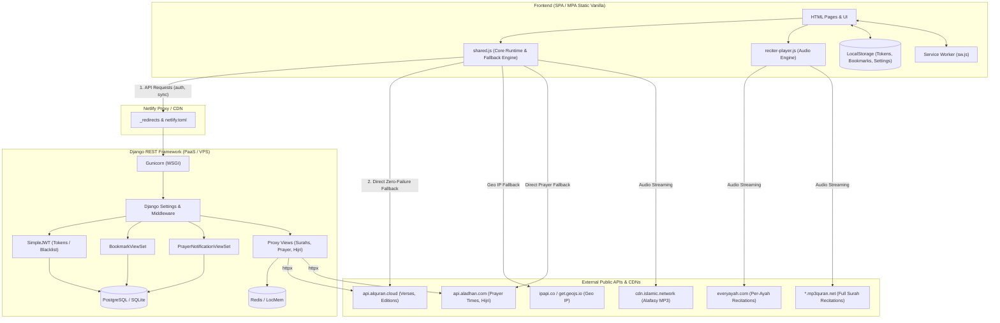

# ЭТАП 0: Разведка и Архитектурный Обзор — Noor Al-Quran

**Дата аудита:** 18 ноября 2026  
**Аудитор:** Senior Staff Engineer / AppSec / QA Lead / DevOps  
**Репозиторий:** `nur-quran` (ветка: `master`, HEAD: `14b4733`)  
**Статус проверки этапа:** Завершён  

---

## 1. Стек технологий, фреймворки и версии

### Backend
- **Язык:** Python `3.12.3` (зафиксирован в `backend/runtime.txt` и `backend/.python-version`).
- **Web-фреймворк:** Django `5.0.6` (`backend/requirements.txt`).
- **REST API:** Django REST Framework (DRF) `3.15.2`.
- **Аутентификация:** `djangorestframework-simplejwt` `5.5.1` (с поддержкой `token_blacklist`).
- **Фильтрация и CORS:** `django-filter` `24.2`, `django-cors-headers` `4.3.1`.
- **HTTP-клиент:** `httpx` `0.25.1` (для проксирования внешних запросов).
- **WSGI-сервер:** `gunicorn` `22.0.0`.
- **База данных:** SQLite 3 (локально `db.sqlite3`), PostgreSQL (`psycopg2-binary` `2.9.9`, подключение через `dj-database-url` `2.1.0`).
- **Кэширование:** In-memory `LocMemCache` (по умолчанию) / Redis через `django-redis` `5.4.0` (опционально при наличии `REDIS_URL`).
- **Статика:** `whitenoise` `6.6.0` (`CompressedManifestStaticFilesStorage`).

### Frontend
- **Архитектура:** Vanilla HTML5, CSS3 (Custom Properties, Flexbox, CSS Grid), Vanilla JavaScript (ES6+ модули без бандлера/Webpack/Vite).
- **PWA:** Service Worker (`sw.js`, версия кэша `noor-quran-v1.2`), `manifest.json`.
- **i18n:** Клиентский словарь `frontend/i18n.js` (поддержка языков: `en`, `ru`, `uz`).
- **Шрифты:** Google Fonts (`Cinzel Decorative`, `Lato`, `Amiri`, `Scheherazade New`).

### Инфраструктура и Деплой
- **Frontend хостинг:** Netlify (`netlify.toml`, `frontend/_redirects`).
- **Backend хостинг:** Render / Railway (`backend/Procfile`, Gunicorn bind на `$PORT`).
- **CI/CD:** Отсутствует (нет `.github/workflows/`, GitLab CI или иных пайплайнов автоматического тестирования и деплоя).

---

## 2. Структура проекта и точки входа

```
nur-quran/
├── AUDIT/                                # Результаты полного предрелизного аудита
├── backend/                              # Django REST Framework бэкенд
│   ├── api/                              # Основное Django-приложение
│   │   ├── management/commands/          # Кастомные django-admin команды
│   │   ├── migrations/                   # Миграции БД (0001–0004)
│   │   ├── admin.py                      # Django Admin для моделей Bookmark, PrayerNotification
│   │   ├── apps.py                       # ApiConfig
│   │   ├── middleware.py                 # SecurityHeadersMiddleware (CSP, Permissions-Policy)
│   │   ├── models.py                     # Модели Bookmark, PrayerNotification
│   │   ├── serializers.py                # Сериализаторы DRF + валидаторы
│   │   ├── tests.py                      # Юнит-тесты Django
│   │   ├── urls.py                       # Маршруты /api/*
│   │   └── views.py                      # Контроллеры API, JWT, 99 Имен
│   ├── config/                           # Конфигурация Django проекта
│   │   ├── settings.py                   # Настройки Django, DRF, CORS, JWT
│   │   ├── urls.py                       # Корневой URLConf (/admin/, /api/)
│   │   └── wsgi.py                       # WSGI точка входа для Gunicorn
│   ├── .env.example                      # Шаблон переменных окружения
│   ├── .gitignore                        # Игнорируемые файлы бэкенда
│   ├── .python-version                   # 3.12.3
│   ├── manage.py                         # CLI утилита Django
│   ├── Procfile                          # Команда запуска для PaaS
│   ├── requirements.txt                  # Зависимости Python
│   └── runtime.txt                       # 3.12.3
├── frontend/                             # Статический фронтенд
│   ├── assets/                           # Статические ресурсы (логотипы, WebP чтецов)
│   ├── audio/                            # Локальные MP3 аудиофайлы (Mossad, Sherif Mostafa)
│   ├── pages/                            # Страницы приложения (21 HTML-файл)
│   │   ├── quran.html                    # Чтение Корана и аятов
│   │   ├── reciters.html                 # Каталог чтецов
│   │   ├── reciter-*.html                # 10 персональных страниц чтецов
│   │   ├── prayer.html                   # Время намаза
│   │   ├── qibla.html                    # Компас Киблы
│   │   ├── tasbih.html                   # Электронный тасбих
│   │   ├── hadith.html                   # Сборник хадисов
│   │   ├── names.html                    # 99 Имен Аллаха
│   │   ├── dua.html                      # Ежедневные дуа
│   │   ├── hijri.html                    # Календарь Хиджры
│   │   ├── bookmarks.html                # Управление закладками
│   │   ├── login.html                    # Авторизация
│   │   └── register.html                 # Регистрация
│   ├── _redirects                        # Netlify redirects для проксирования API
│   ├── i18n.js                           # Словарь переводов (RU, EN, UZ)
│   ├── index.html                        # Главная посадочная страница (Dashboard)
│   ├── manifest.json                     # PWA манифест
│   ├── netlify.toml                      # Netlify headers и redirects
│   ├── package.json                      # NPM метаданные и npm scripts
│   ├── reciter-player.js                 # Плеер страниц чтецов (поаятный и полносуровый)
│   ├── robots.txt                        # Директивы поисковых роботов
│   ├── shared.css                        # Единые стили, тема, компоненты, адаптив
│   ├── shared.js                         # Ядро логики, плеер, fallback-клиент, authFetch
│   ├── sitemap.xml                       # Карта сайта
│   └── sw.js                             # Service Worker (PWA offline)
├── .gitignore                            # Корневой .gitignore
├── LICENSE                               # MIT License
├── netlify.toml                          # Корневой конфиг Netlify
└── README.md                             # Документация проекта
```

---

## 3. Архитектурная карта проекта



---

## 4. Сравнение: заявленные vs реально существующие функции

| Функция | Заявлено в README | Реальное состояние в коде | Статус |
|---|---|---|---|
| **Чтение 114 сур** | Все 114 сур с текстом, переводом, транслитерацией | Метаданные 114 сур зашиты в `SURAHS` (`shared.js`). Текст аятов подгружается динамически через `fetchSurahData()`. | ⚠️ РАБОТАЕТ С ПРОБЛЕМАМИ |
| **Переводы (EN, RU, UZ)** | Доступны 3 перевода | Запрашиваются `en.asad`, `ru.kuliev`, `uz.sodik` через API. При оффлайне/сбое перевода нет локального словаря текстов аятов. | ⚠️ РАБОТАЕТ С ПРОБЛЕМАМИ |
| **Шрифты и огласовки** | `Amiri`, `Scheherazade New`, Tashkeel | Google Fonts подключены в CSS. Размер шрифта меняется через `applyReadingSettings()`. | ✅ РАБОТАЕТ |
| **Аудиоплеер Корана** | Sticky плеер, скорость, повтор, MediaSession | Реализовано в `shared.js` и `reciter-player.js`. Но логика разделена на 2 разных движка, дублирующих друг друга. | ⚠️ РАБОТАЕТ С ПРОБЛЕМАМИ |
| **Каталог 10 чтецов** | 10 чтецов мирового уровня | 10 страниц созданы. Часть аудио на EveryAyah, часть на MP3Quran, 10 файлов локально в `/audio/`. | ⚠️ РАБОТАЕТ С ПРОБЛЕМАМИ |
| **Времена намаза** | Автоматический расчет по геолокации + оффлайн fallback | Запрос к Aladhan API. При отказе есть математический расчет `calculatePrayerTimesJS()`. | ✅ РАБОТАЕТ |
| **PWA & Offline** | Service Worker, оффлайн-кэш | `sw.js` зарегистрирован, кэширует статику. Оффлайн-чтение ограничено кэшированными страницами. | ⚠️ РАБОТАЕТ С ПРОБЛЕМАМИ |
| **Харденинг и безопасность** | CSP, Rate-limit 5 req/min, JWT Token Rotation | Rate-limit и JWT Rotation в коде бэкенда есть. НО `SecurityHeadersMiddleware` (CSP) НЕ ПОДКЛЮЧЕН в `settings.py`! | ❌ СЛОМАНО |
| **Синхронизация закладок** | Cloud Bookmarks через JWT | Реализована модель, сериализатор и эндпоинт `/api/bookmarks/`. Есть локальный fallback в LocalStorage. | ✅ РАБОТАЕТ |
| **Тасбих** | Цифровой счетчик, вибрация, сессии | В `tasbih.html` реализован интерфейс, LocalStorage история, Web Vibration API. | ✅ РАБОТАЕТ |
| **Компас Киблы** | Расчет направления по координатам | Реализовано в `qibla.html` (DeviceOrientationEvent + формула Haversine). | ✅ РАБОТАЕТ |
| **Календарь Хиджры** | Конвертация дат | Запрашивает `/api/hijri-date/` или рассчитывает локально. | ✅ РАБОТАЕТ |
| **Ежедневные дуа** | Каталог дуа | Статический массив дуа в `dua.html`. | ✅ РАБОТАЕТ |
| **Сборник хадисов** | Чтение хадисов | Загружает JSON хадисов с внешнего репозитория/API. | ⚠️ РАБОТАЕТ С ПРОБЛЕМАМИ |
| **99 Имен Аллаха** | Все 99 Имен | Зашиты в `backend/api/views.py` и `frontend/shared.js` (`NAMES_OF_ALLAH_DATA`). | ✅ РАБОТАЕТ |
| **Уведомления о намазе** | Модель PrayerNotification | Модель есть, но в `PRAYER_CHOICES` пропущена молитва `Isha`! На бэкенде нет фонового планировщика (Celery/Cron) для отправки push-уведомлений. | ❌ СЛОМАНО / НЕДОДЕЛАНО |

---

## 5. Первичные критические архитектурные находки

1. **Мёртвый CSP Middleware (Бэкенд):** Файл `backend/api/middleware.py` содержит полноценную реализацию `SecurityHeadersMiddleware`, однако в `backend/config/settings.py` в кортеже `MIDDLEWARE` этот класс **не зарегистрирован**. Заголовки CSP на уровне Django не отдаются.
2. **Фактическая ошибка в религиозных данных (Бэкенд):** В `backend/api/models.py` в модели `PrayerNotification` список молитв `PRAYER_CHOICES` содержит только `fajr`, `sunrise`, `dhuhr`, `asr`, `maghrib`. **Ночная молитва `Isha` (Иша) полностью отсутствует в перечислении!** Пользователь не может включить уведомление на обязательный 5-й намаз.
3. **Подмена чтеца в метаданных (Бэкенд):** В `backend/api/views.py` в словаре `RECITER_EDITIONS` для чтеца `'ghamdi'` (Саад аль-Гамиди) указан идентификатор `'ar.saoodshuraym'` (Сауд аш-Шурейм) — это два разных человека.
4. **Уязвимость в валидации закладок:** Сериализатор `BookmarkSerializer` допускает `ayah_number` до 286 для любой суры (включая Аль-Фатиху, где всего 7 аятов).
5. **Рассинхронизация доменов в Netlify и settings.py:** В `netlify.toml` перенаправления настроены на `https://nur-quran.onrender.com`, а в `backend/config/settings.py` по умолчанию `CORS_ALLOWED_ORIGINS` ожидает `https://nuur-quran.netlify.app` (две буквы `u`). При несовпадении доменов реальный запрос заблокируется CORS.

---
**ЭТАП 0 ЗАВЕРШЁН: проверено 17 файлов, найдено 5 проблем**
